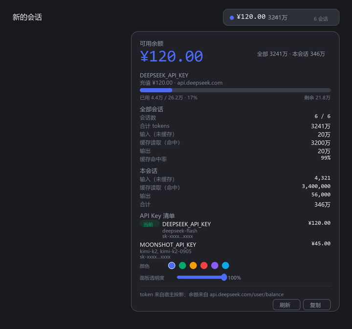

# dsh-token-usage-panel

**DeepSeek Harness 的实时 token 用量与账户余额面板。** 在会话标题旁显示一枚胶囊，点开是一张明细表：本会话和所有会话消耗了多少 token、当前模型对应哪把 API Key、这把 Key 的余额还剩多少。



> 示意渲染，非真实截图，数据均为示例值。

## 功能

| 功能 | 说明 |
|---|---|
| **实时 token 统计** | 本会话四桶（未缓存输入 / 缓存读取 / 缓存写入 / 输出）+ 缓存命中率，随对话逐步骤更新 |
| **全部会话汇总** | 逐个会话读宿主 `session/projections`（完整持久日志），给出会话数、合计 tokens、分项与 Top 4 会话，不受页面推送滞后影响 |
| **账户余额（官方接口）** | 宿主侧代调 `https://api.deepseek.com/user/balance`，显示可用 / 充值 / 赠金；浏览器不接触密钥 |
| **余额随模型自动切换** | 按当前会话的模型匹配到对应 API Key 的钱包：模型 id 精确命中 → provider/baseURL 命中 → Key 名字族 → 兜底 |
| **启动扫描 API Key** | 每次启动读 `$DSH_HOME/.credentials.yaml` 的 `refs:` 段，把 Key 与其服务的 provider / 模型对应起来，新出现的 Key 打「新」标记 |
| **上下文压力** | 已用 / 窗口 / 剩余 + 占用进度条（≥70% 转黄、≥90% 转红） |
| **上下文构成（估算）** | 系统提示 / 工具声明 / 消息三类 token |
| **速度指标** | 轮次 / 步数、生成 tok/s、首字延迟、模型用时、工具用时 |
| **大数字易读** | 中文用 万 / 亿，英文用 k / M / B；金额保持货币精度 |
| **外观可调** | 6 个预设色 + 任意取色器；面板透明度滑杆（20%–100%） |
| **自适应** | 胶囊与面板随窗口连续缩放（`--dsh-tup-scale`），窄窗收窄、空间不足自动翻到胶囊上方 |
| **一键复制** | 把当前读数复制成纯文本摘要 |

## 数据从哪来

| 来源 | 用途 |
|---|---|
| `session/projections`（宿主 Remote） | 每个会话的全量 `tokenUsage`，供跨会话汇总 |
| `tokenUsage` / `contextPressure` / `contextBreakdown` / `sessionStats` 投影 | 本会话的实时明细 |
| `modelSelection` 投影 | 判断当前模型，选中对应钱包 |
| `GET https://api.deepseek.com/user/balance` | 余额（经宿主同源路由转发） |

插件不写会话日志、不产生任何模型可见内容。

## 安装

插件由两半组成：宿主半侧注册同源路由并读取凭据，浏览器半侧提供胶囊与面板。

```bash
git clone https://github.com/gucheng990615/dsh-token-usage-panel.git
cd dsh-token-usage-panel
```

1. 把包链接进你的 profile：

```powershell
# Windows（PowerShell）
$profileDir = "$env:USERPROFILE\.dsh\profiles\desktop"   # 或 $env:DSH_PROFILE_DIR
New-Item -ItemType Junction -Path "$profileDir\node_modules\dsh-token-usage-panel" -Target (Get-Location)
```

2. 在 profile 的 `cordis.patch.yml` 末尾加一行装载配置：

```yaml
- insert:
    - id: token-usage-panel
      name: dsh-token-usage-panel
      config:
        apiKeyEnv: DEEPSEEK_API_KEY   # 可选：官方余额用的密钥名
```

3. 重启 DeepSeek Harness（宿主模块不会被热加载）。

仓库里的 `install.ps1` 会把上面两步做幂等处理：

```powershell
powershell -ExecutionPolicy Bypass -File .\install.ps1
```

## 配置 API Key

胶囊的余额来自官方 `/user/balance`，需要一个 `sk-` 开头的 DeepSeek API Key。解析顺序（先命中先用）：

1. 装载配置里的 `apiKey`
2. 装载配置的 `apiKeyEnv`（默认 `DEEPSEEK_API_KEY`）→ 宿主 credentials 服务
3. 同名环境变量
4. `$DSH_HOME/.dsh-token-usage-panel.json`，形如 `{ "apiKey": "sk-…" }`（建议权限 600）

> Key 只在宿主进程内使用，页面只拿到余额数字。

## 自定义

| 想改什么 | 改哪里 |
|---|---|
| 余额接口 / provider 支持 | `lib/index.js` 的 `readBalanceFor()` 与 `readDeepSeekBalance()` / `readMoonshotBalance()` |
| Key → 模型映射 | 自动读 profile 的 `providers:` 块；失败时按 Key 名推断，见 `inferProvider()` |
| 默认色、圆角、字号 | `client.js` 顶部的 `CSS` 数组（全部基于设计令牌 + `--dsh-tup-*` 变量） |
| 悬浮位置 | `computePanelPosition()`（纯函数，方便测试） |
| 数字格式 | `formatCount()`（万/亿 vs k/M/B）、`formatMoney()` |

## 开发

```bash
node --check client.js        # 语法
npm test                      # 渲染冒烟测试：词典对齐、t() 键、胶囊/面板渲染、钱包匹配、缩放、透明度
```

`tests/render-smoke.mjs` 用 stub React 真正执行一次组件，能抓到语法检查抓不到的「重构后残留变量」类崩溃。

示例图由脚本生成：

```bash
python docs/render-example.py docs/example.png
```

## 已知限制

- **宿主半侧改动必须重启**：`hmr.root` 默认为空，宿主模块不热加载；`client.js` 改动也需要页面重新拿 bundle。
- **「已用」不显示**：官方接口只返回余额，没有花费字段；余额差值不是账单，因此不做展示。
- **非 DeepSeek / Moonshot 的钱包**：没有已知余额接口，会在清单里显示「—」。
- 需要 `rgb(from …)` 相对颜色语法（Chromium 119+，Electron 桌面端满足）。

## 许可

MIT，见 [LICENSE](LICENSE)。

---

### English summary

A DeepSeek Harness plugin that shows live token usage (this session and all sessions) plus the
official account balance next to the session title. It reads Session projections from the Host,
maps API keys found in `$DSH_HOME/.credentials.yaml` to the providers and models that consume
them, and forwards `GET https://api.deepseek.com/user/balance` through a same-origin Host route
so the browser never sees the key. Install by linking the package into a profile and adding one
`insert` row to `cordis.patch.yml`; restart the app afterwards.
